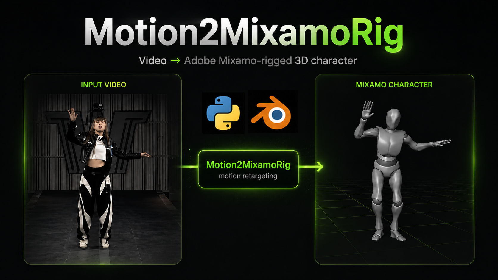

# Motion2MixamoRig

<p align="center">
  <a href="#前置需求"></a>
  <a href="../../blender_extension/README.md"></a>
  <a href="https://github.com/MaxLiu22/Motion2MixamoRig/stargazers"></a>
</p>



<p align="center">
  <a href="README.zh-Hans.md">简体中文</a> · 繁體中文 · <a href="../../README.md">English</a> · <a href="README.ko.md">한국어</a> · <a href="README.ja.md">日本語</a> · <a href="README.de.md">Deutsch</a> · <a href="README.ru.md">Русский</a> · <a href="README.ar.md">العربية</a> · <a href="README.vi.md">Tiếng Việt</a> · <a href="README.fil.md">Filipino</a> · <a href="README.th.md">ไทย</a> · <a href="README.fr.md">Français</a> · <a href="README.es-MX.md">Español</a> · <a href="README.tr.md">Türkçe</a> · <a href="README.ne.md">नेपाली</a> · <a href="README.id.md">Bahasa Indonesia</a> · <a href="README.pl.md">Polski</a> · <a href="README.nl.md">Nederlands</a>
</p>

把影片中人物的動作，或一張照片裡的姿勢，轉移到用 Adobe Mixamo rig 好的 3D 角色上。

給遊戲開發者：輸入一段**單人**動作影片（或一張人物照片）和一個 Mixamo 角色，就會輸出預覽影片，以及可以直接放進 Blender / Unity 的已蒙皮角色檔（`.glb`）。

> Motion2MixamoRig 目前仍在實驗階段。v0.1.6 是命令列工作流程。本儲存庫另外提供一個 Blender 4.2+ Extension，會在外部的 Python 環境中執行同一條 pipeline。外掛的安裝與使用方式請見 [`blender_extension/README.md`](../../blender_extension/README.md)。

Agent 請先閱讀 [`AGENTS.md`](../../AGENTS.md)。

https://github.com/user-attachments/assets/37c67642-f36c-4815-bcf3-028ed9546a2f

<p align="center">
  <sub>開啟本儲存庫中的 <a href="../assets/demo.mp4">demo.mp4</a>。</sub>
</p>

另一個 demo：

https://github.com/user-attachments/assets/073f20c8-7283-4209-98e8-f247228bfd56

## 前置需求

需要 Python 3.11+。clone 之後建立虛擬環境並安裝相依套件，就可以使用 `m2mr` 指令：

```bash
git clone https://github.com/MaxLiu22/Motion2MixamoRig.git
cd Motion2MixamoRig
python -m venv .venv && source .venv/bin/activate

# 安裝相依套件與本專案。chumpy（相依鏈中的舊套件）的建置腳本會 import pip，
# 在 pip 預設的隔離建置環境中一定會出現 "No module named 'pip'"，
# 所以要先關閉隔離（--no-build-isolation）單獨安裝它，再安裝本專案。
pip install --upgrade pip setuptools wheel \
  && pip install "numpy>=1.26" \
  && pip install --no-build-isolation "chumpy==0.70" \
  && pip install -e .
```

推論權重（GVHMR 等）不會在這一步下載，第一次執行 `m2mr run` 時會自動下載到 `weights/`（約 5 GB，只需下載一次）。

建議另外安裝 ffmpeg（macOS：`brew install ffmpeg`，Ubuntu：`apt install ffmpeg`）。
沒有它也能執行，但輸出的影片會**沒有聲音**，編碼格式也無法直接在瀏覽器中播放。

## 執行前：把這些檔案放到 `assets/`

本儲存庫不附帶這些檔案，需要你自行準備。SMPL-X 的檔名必須和下表完全一致；FBX、影片和照片的檔名可以隨意。每次執行需要 SMPL-X、一個 Mixamo 角色，以及**影片或照片二選一**。

| 放什麼 | 放在哪裡 | 去哪裡取得 |
|---|---|---|
| SMPL-X 人體模型 | `assets/body_models/smplx/SMPLX_NEUTRAL.npz` | 在 [SMPL-X](https://smpl-x.is.tue.mpg.de/) 註冊後下載 |
| Mixamo 角色 FBX | `assets/mixamo/Y_Bot.fbx` | 用 Adobe 帳號從 [Mixamo](https://www.mixamo.com) 下載 Y Bot（或其他用 Mixamo rig 好的角色） |
| 動作影片 | `assets/video/<your_clip>.mp4` | **只有一個人**、人物清楚可見、**從頭到腳全程都在畫面內**（可以放多個檔案，每次執行會使用最新加入的那一個） |
| 姿勢照片（選用） | `assets/image/<your_photo>.jpg` | **只有一個人**、人物清楚可見、**從頭到腳都在畫面內**。搭配 `--image` 使用 |

注意：從 Mixamo 下載的檔名是 `Y Bot.fbx`（中間是**空格**），和上表的 `Y_Bot.fbx`（**底線**）差一個字元。
改成底線後它就是預設 rig，`m2mr run` 不加 `--rig` 時會自動使用它；不改名也可以——找不到 `Y_Bot.fbx` 時，
會自動使用 `assets/mixamo/` 中的第一個 `.fbx`。

`assets/video/` 可以放多個影片檔。沒有指定 `--video` 或 `--image` 時，會使用**最後放進 `assets/video/` 的影片**；如果這個資料夾是空的，就改用 `assets/image/` 中最新的一張照片。
每段影片或每張照片中只能有一個人，而且人物必須**從頭到腳都在畫面內**，不能被裁切。`m2mr doctor` / `m2mr run` 偵測到兩個人時會直接停止，不會進入擷取步驟。

## 快速開始

結果都會放在 `outputs/<執行時間>_<輸入名稱>/`。影片輸入會寫到 `videos/`，照片輸入會寫到 `images/`。

### 1. 檢查資源與環境

缺少什麼會告訴你去哪裡下載、放到哪裡。

```bash
m2mr doctor
```

### 2. 第一次執行：先得到一個看得到的結果

不加任何參數時，會使用**最後放進 `assets/video/` 的影片** + `assets/mixamo/Y_Bot.fbx`。

```bash
m2mr run
```

這一步最慢。第一次執行會先下載約 5 GB 的推論權重（只需一次），接著從影片中擷取人體動作。
一段約 30 秒的影片，在 CPU 上擷取大約需要 8–15 分鐘；權重下載完成後，再處理類似長度的影片大約需要 3–5 分鐘。
後面的重定向與算繪通常只需一兩分鐘。使用下一節的 `--skeleton` 重複利用骨架時，會完全跳過擷取，幾十秒就能得到結果。

### 3. 同一段動作，換一個角色

從 Mixamo 下載其他角色放進 `assets/mixamo/`。**不要只改 `--rig` 就重新執行**——這樣最慢的
動作擷取會整個重來一次。使用 `--skeleton` 重複利用上一次執行擷取好的骨架，幾分鐘的事就變成幾十秒：

```bash
m2mr run --skeleton outputs/<上次的執行目錄>/skeleton_motion.npz --rig assets/mixamo/Vampire.fbx
```

### 4. 換一段影片

`--video` 用來指定使用哪一段影片，可以和 `--rig` 任意搭配。

```bash
m2mr run --video assets/video/dance.mp4 --rig assets/mixamo/Vampire.fbx
```

### 5. 使用一張照片（靜態姿勢）

`--image` 會從**單人照片**還原出一個靜態的 3D 姿勢，再用和影片相同的流程轉移到 Mixamo 角色上。預覽是 `images/` 中的四張靜態圖（種類和影片執行相同），另外還有一段左右對照的環繞影片 `before_after_360_compare.mp4`。不要和 `--video` 一起使用。

```bash
m2mr run --image assets/image/pose.jpg
m2mr run --image assets/image/pose.jpg --rig assets/mixamo/Vampire.fbx
```

`--image` 不加路徑時，會使用 `assets/image/` 中最後放進去的那一張。

## 輸出

每次執行 `m2mr run` 都會依**指令開始執行的時間**建立一個新目錄。根目錄的四個檔案在影片和照片輸入時都相同，只有預覽資料夾會不同。

```
outputs/20260829_193205_dance/          # 照片執行則是 …_pose/
├── run.json                            # 開始時間、輸入、完整指令
├── skeleton_motion.npz                 # 人體 3D 骨架（可用 --skeleton 重複利用）
├── mixamo_rotations.npz                # Mixamo 每根骨骼的旋轉
├── mixamo_character.glb                # 已蒙皮角色，可匯入 Blender / Unity
└── videos/   或   images/              # 預覽 — 取決於這次輸入的是影片還是照片
```

**影片輸入**會寫到 `videos/`（長寬比和原始片段相同）：

```
videos/
├── human_skeleton.mp4                  # 還原出的人體 3D 骨架
├── mixamo_skeleton.mp4                 # Mixamo rig 骨架
├── mixamo_character.mp4                # 已蒙皮的 Mixamo 角色
└── compare.mp4                         # 四格對照：左上原始影片 / 右上 Mixamo 骨架
                                        #         左下人體骨架 / 右下角色
```

**照片輸入**則會寫到 `images/`（四種圖和上面一一對應，另外加一段環繞影片）：

```
images/
├── human_skeleton.png                  # 還原出的人體 3D 骨架
├── mixamo_skeleton.png                 # Mixamo rig 骨架
├── mixamo_character.png                # 已蒙皮的 Mixamo 角色
├── compare.png                         # 四格對照：左上原始照片 / 右上 Mixamo 骨架
│                                       #         左下人體骨架 / 右下角色
└── before_after_360_compare.mp4        # 左：原始照片
                                        # 右：每 10° 環繞角色一圈
```

用 Blender 開啟 `mixamo_character.glb`：File → Import → glTF 2.0 (.glb/.gltf)。匯入後如果鏡頭沒有對準角色，請選取角色網格，再使用 View → Frame Selected。頭部和手上那一堆球是骨骼的顯示形狀，不是模型本身：在 Outliner 中隱藏 **Icosphere** 和骨架（armature），保留已蒙皮的網格。時間軸的 FPS 和結束影格請依照 `run.json` 中的 `fps` / `n_frames` 設定，播放長度才會和原始影片一致。影片執行請對照 `videos/mixamo_character.mp4`，照片執行請對照 `images/mixamo_character.png` 或那段環繞影片。

## 授權

本儲存庫的程式碼採用 Apache-2.0 授權。你自行取得的資源各有其條款，不可隨本儲存庫重新散布：

- **SMPL-X**：需經 MPI 授權取得，預設僅限非商業的研究 / 教育 / 藝術用途；商業使用需另行洽談
- **Mixamo FBX**：可以用在發行的產品中，但不可將原始 FBX 當成素材包散布
- **GVHMR 等推論權重**：第一次執行 `m2mr run` 時會自動下載到 `weights/`，並遵循各自上游專案的授權

## 聯絡方式

如果在使用中遇到問題、需要協助完成本機環境建置，或希望洽談合作，歡迎透過電子郵件與我聯絡：
[maxliu2022sz@gmail.com](mailto:maxliu2022sz@gmail.com)
